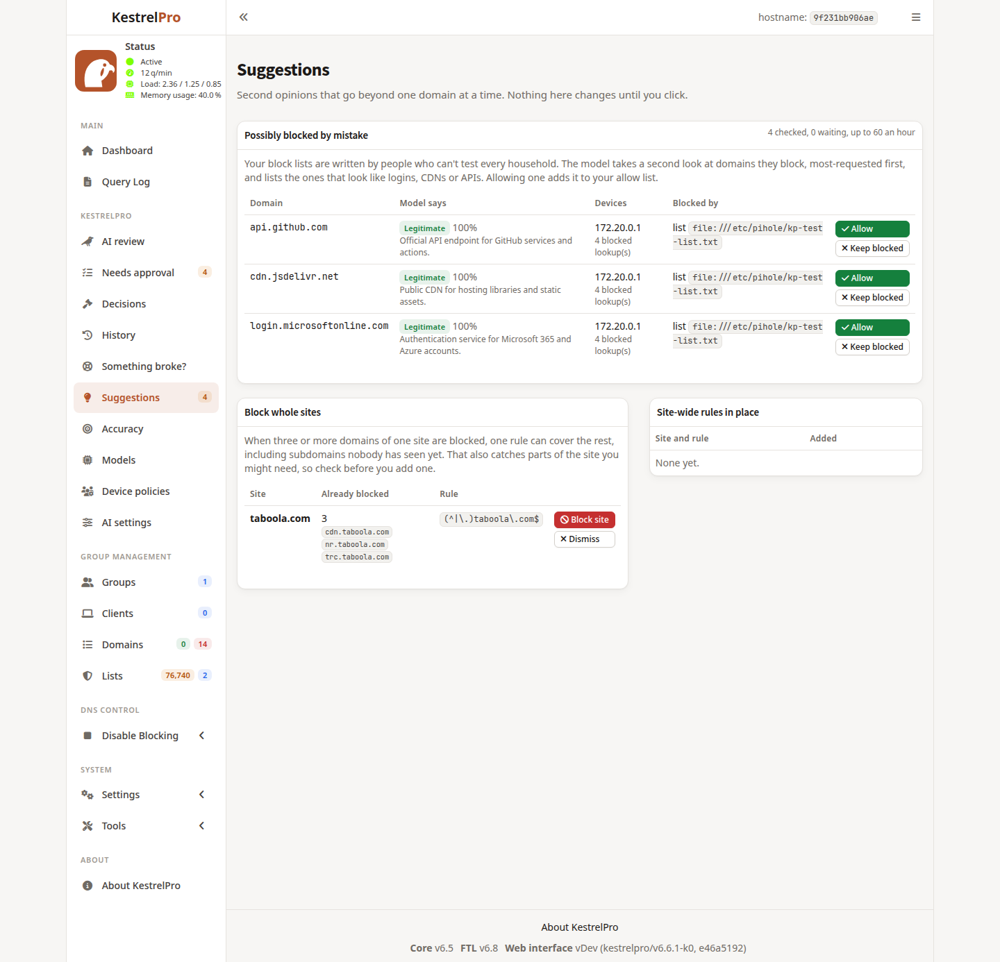
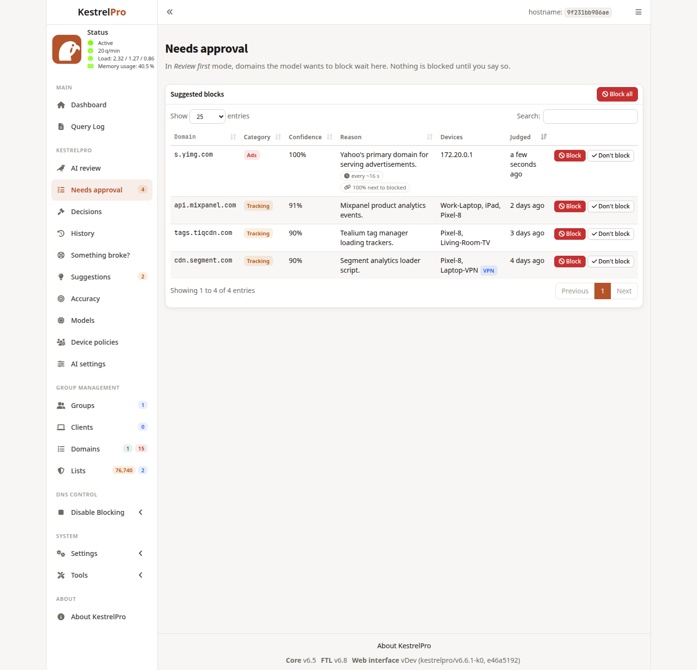

# KestrelPro

**A drop-in replacement for your Pi-hole® that also catches what the block lists miss.**
KestrelPro keeps doing everything your Pi-hole does (same lists, same settings, runs on the same
Raspberry Pi) and adds a language model, running on your own hardware, that looks at every new
domain your devices use and blocks the ads, trackers and malicious domains that aren't on any
list yet. Nothing is sent to the cloud.


- **One appliance, one login.** A fork of Pi-hole® v6 with the review engine built in and its
  pages in the admin UI.
- **Careful by default.** Suggestions wait for your approval until you switch to Automatic;
  automatic blocks go on a trial period, one click pauses them all, and every decision can be
  undone.
- **Measured, not trusted.** Your own Block / Don't block decisions grade the model, compare
  models, and can teach it.
- **Per device.** Different rules for different groups of devices (kids' tablets, work laptops).

KestrelPro's own code (this repository) is MIT-licensed; the admin UI and image build are
modified versions of Pi-hole software and stay under Pi-hole's EUPL-1.2 (see
[License](#license)). Pi-hole is a registered trademark of Pi-hole, LLC. KestrelPro is not affiliated with or endorsed by Pi-hole, LLC.

## Requirements

- A Linux machine with **Docker** and Docker Compose v2 that your devices can reach on port 53:
  a Raspberry Pi (64-bit or 32-bit Raspberry Pi OS) or any x86-64 PC or server.
- **An Ollama model server** for the AI review: bundled in the compose file, or any Ollama on
  your network. KestrelPro keeps blocking with your lists when the model is unavailable.

| Where the model runs | Suggested model | Review speed |
|---|---|---|
| A PC or server with an NVIDIA or AMD GPU, 8 GB+ | `gemma4:12b` (default, ~8 GB) | seconds per batch: real-time mode |
| A CPU-only PC, or a small GPU | a 3–4B model | a few minutes per batch: Eco mode (`CADENCE=eco`) |
| On the Raspberry Pi itself (Pi 5, 8 GB) | a 1–3B model | slow: Eco mode; check its accuracy first |

Any Ollama model with structured JSON output works. Compare candidates on the **Models** page:
*Benchmark* grades each against your own Block / Don't block decisions.

### On a Raspberry Pi

The Pi easily runs DNS, the block lists and KestrelPro's engine (a small Python process). It
can't run a model the size that judges domains well, so the usual setup is:

1. **KestrelPro on the Pi**, replacing Pi-hole (see [docs/MIGRATING.md](docs/MIGRATING.md)).
   In `.env`, remove `ollama` from `COMPOSE_PROFILES` and set `OLLAMA_URL` to the other machine.
   The same image runs on the Pi; nothing to build.
2. **Ollama on any computer with a GPU** on your network (`ollama serve` with
   `OLLAMA_HOST=0.0.0.0`), with the model pulled there.

When that computer is off, KestrelPro keeps blocking with your lists and new domains wait
until the model is back. On a Pi 5 with 8 GB you can also run a small model on the Pi itself
in Eco mode; it's slow and less accurate, so benchmark it first. Building the image on the Pi
isn't needed: `docker compose up -d` pulls the Pi's version of the image.

## Quick start

You need only two files; the image is ready-made for PCs and Raspberry Pi.

```bash
mkdir kestrelpro && cd kestrelpro
curl -fsSLO https://raw.githubusercontent.com/amukherjee1991/kestrelpro/main/compose.yaml
curl -fsSL https://raw.githubusercontent.com/amukherjee1991/kestrelpro/main/.env.example -o .env
nano .env                          # set ADMIN_PASSWORD (and TZ)
docker compose up -d               # with a GPU for the model: add -f compose.nvidia.yaml (or compose.amd.yaml)
docker compose exec ollama ollama pull gemma4:12b
```

Then:

1. Open the admin UI at `http://<host>:8080/admin/` and sign in with `ADMIN_PASSWORD`.
2. Point your devices at the host for DNS. The usual way is your router's DHCP settings.
3. Watch **KestrelPro → AI review** and **Needs approval** for a few days before you switch
   *AI settings* to Automatic.

Updating: `docker compose pull && docker compose up -d`. Pin a version with
`KESTRELPRO_VERSION` in `.env`.

**On Ubuntu**, follow **[docs/UBUNTU.md](docs/UBUNTU.md)**: Docker, port 53, GPU drivers and
firewall, step by step.

If `docker compose up` says port 53 is in use, or you're replacing an existing Pi-hole or the
Kestrel add-on, see **[docs/MIGRATING.md](docs/MIGRATING.md)**.

### How the browser reaches the engine

- **Default:** the KestrelPro pages call the engine on the same host at `KESTREL_ENGINE_PORT`
  (8090); the container allows that in the admin UI's Content-Security-Policy on start-up.
  This needs plain HTTP, because a page served over HTTPS can't call an HTTP engine.
- **Behind a reverse proxy (recommended with HTTPS):** route `/admin/api/kestrel/*` to the
  engine and everything else to the admin UI, then set `KESTREL_ENGINE_URL=/admin/api/kestrel`.
  For example, with Caddy:

  ```caddyfile
  dns.example.lan {
      reverse_proxy /admin/api/kestrel/* kestrelpro-host:8090
      reverse_proxy kestrelpro-host:8080
  }
  ```

The engine accepts a request only with a live admin-UI session (checked with the DNS server,
cached for 10 s), and changes also need that session's CSRF token. The admin UI must have a
password.

## Features

### Safety net

- **Trial period.** A new automatic block is on trial for 24 h. It is withdrawn (back to
  *Needs approval*) if you unblock another domain of the same site, or if two or more devices
  each retry it 20+ times within 5 minutes, which is what broken apps do. Tunable in AI settings.
- **Pause.** *Pause KestrelPro blocks* on the AI review page (or `kestrel_engine pause`)
  disables every block KestrelPro added, without deleting anything; *Resume* turns them back
  on. Your block lists are not affected. While paused, Automatic mode only suggests.
- **Something broke?** Pick a device and a time window to see the KestrelPro blocks it ran
  into, busiest first, with *Unblock* and *Never block*.
- **Query Log.** Domains KestrelPro has judged get an AI badge. Clicking it shows the verdict,
  which list or rule blocked the domain, and one-click actions.

| | |
|---|---|
|  |  |
| AI verdict in the Query Log | Something broke? |

### Device policies, models and accuracy

- **Device policies.** Give a group of devices (Group Management → Clients) its own rules:
  same as AI settings, Review first, Automatic or Off, with its own threshold and kinds of
  domain. An automatic block made under a group's policy is assigned to that group only, so
  other devices are unaffected; Decisions labels it, e.g. "Kids only". Blocks you make or
  approve yourself apply to everyone. A device only in a non-Default group gets no block lists
  unless they're assigned to that group too; the page warns about such groups.
- **Models.** Installed models with GPU/CPU placement; download with progress; *Use* switches
  and pins the exact build (a later `ollama pull` that changes it shows a warning until you
  re-pin); delete; *Benchmark* grades a model against your own decisions.
- **Accuracy.** Your *Block* / *Don't block* decisions are a labelled set: how often the model
  agrees with you, by category and model, and where you disagree. With *Learn from my
  decisions* on (AI settings), a few recent decisions are shown to the model as examples;
  verdicts made that way carry a `+fs` prompt version.

| | |
|---|---|
|  |  |
| Device policies | Models and a benchmark |
|  |  |
| Accuracy | Blocks under a device policy |

### Evidence, suggestions and notifications

- **Evidence beyond the name.** With each domain the model also gets local signals from this
  network's own query log: which devices looked it up, whether a device repeats it on a steady
  clock (typical of telemetry and tracking beacons), and how often its lookups came right next
  to lookups that were already blocked. They're hints, not rules, and they can mislead (a CDN
  that loads alongside ads looks guilty by association), so watch the Accuracy page. A domain
  seen for the very first time has only that one lookup; the rhythm shows up on re-reviews and
  in Eco mode. Nothing is looked up on the internet.
- **Second looks at your block lists.** A few domains your lists block are shown to the model
  each hour (most-requested first, only while it's idle). Ones it calls legitimate (a login,
  CDN or API) appear under **Suggestions** with the list responsible and an *Allow* button.
- **Whole-site rules.** When three or more domains of one site are blocked, Suggestions offers
  one regex rule for the site. Pause and undo cover these rules too.
- **Notifications.** ntfy or a JSON webhook, for automatic blocks, a pile-up of approvals,
  withdrawn trial blocks and suspected list mistakes; combined and sent at most every 5
  minutes. Off until you enter an address.

| | |
|---|---|
|  |  |
| Suggestions | Evidence under the reason |

## Screenshots

Taken from a test container filled with made-up data (`engine/tools/seed_demo.py`).

| | |
|---|---|
|  |  |
| Needs approval | Decisions |
|  |  |
| History | AI settings |
|  |  |
| Dark theme | Sign-in |

All screenshots are in [docs/screenshots/](docs/screenshots/), including phone layouts.

### The look

The whole admin UI, not only the KestrelPro pages, uses one modern skin
(`web/style/kestrelpro.css`, dark tokens in `kestrelpro-dark.css`): neutral surfaces, the
falcon's rust as the single accent, stat tiles as cards, soft badges, visible keyboard focus.
Motion is limited to press feedback and the dialog entrance, and is off under the system's
reduced-motion setting. It applies to the Default themes (light, dark, darker, auto); LCARS
and the high-contrast themes are left as upstream ships them.

| | |
|---|---|
|  |  |
| Dashboard | Query Log |
|  |  |
| Domains (dark) | System settings (dark) |

## Development

| Path | What |
|---|---|
| `engine/` | The review engine (Python): query-log ingest, model calls, policies, safety net, API |
| `web/` | Fork of pi-hole/web: admin UI, KestrelPro pages, skin, debranding ([kestrelpro-web](https://github.com/amukherjee1991/kestrelpro-web)) |
| `docker-pi-hole/` | Fork of pi-hole/docker-pi-hole: image build, engine supervision ([kestrelpro-docker](https://github.com/amukherjee1991/kestrelpro-docker)) |
| `compose.yaml`, `.env.example` | How users run it (pulls the ready-made image) |
| `compose.build.yaml`, `forks.json` | Building the image from source; which fork branches |
| `tools/smoke-test.sh` | Boots an image and checks DNS, blocking, admin UI, engine |
| `UPSTREAM.json` | Pinned upstream releases (FTL is also pinned by SHA-256 in the image build) |

```bash
cd engine && python -m unittest discover -s tests -t .      # engine tests
# engine/tools/seed_demo.py fills a *test* container with made-up data (see its docstring)
docker exec kestrelpro sh -c 'cd /opt/kestrel-engine && su-exec kestrel:pihole python3 -m kestrel_engine report'
# also: once | undo | pause | resume
```

How the pieces fit, the fork strategy, the security model and licensing:
**[docs/DESIGN.md](docs/DESIGN.md)**. Pi-hole's marks are removed from the UI by
`web/tools/debrand.sh` (checked by `tools/check-branding.sh`); each fork lists its changes in
`KESTRELPRO-CHANGES.md`.

Build from source: clone the two forks into `web/` and `docker-pi-hole/` (see
`compose.build.yaml`), then `docker compose -f compose.yaml -f compose.build.yaml up -d --build`.

CI: `engine-tests.yml` runs the engine tests on every push; `image.yml` builds and smoke-tests
the image on every push and publishes it for PC and Raspberry Pi on a version tag
([docs/RELEASING.md](docs/RELEASING.md)); `upstream-watch.yml` checks the pinned releases weekly
and opens an issue when Pi-hole publishes newer ones.

## Roadmap

- Opt-in internet evidence (RDAP/WHOIS registration age) for the model.
- A fast, calibrated first-pass classifier in front of the model ([#1](https://github.com/amukherjee1991/kestrelpro/issues/1)).
- Location privacy: the planned per-device location spoofing can't work as designed;
  alternatives are open for decision ([#2](https://github.com/amukherjee1991/kestrelpro/issues/2)).

## License

- **This repository** (the review engine, compose files, tools and docs): [MIT](LICENSE).
- **[kestrelpro-web](https://github.com/amukherjee1991/kestrelpro-web)** and
  **[kestrelpro-docker](https://github.com/amukherjee1991/kestrelpro-docker)**: modified
  Pi-hole software, **EUPL-1.2**, like the originals. The published image contains both, so
  it is distributed under the terms of each part's licence.
- Pi-hole® is a registered trademark of Pi-hole, LLC; KestrelPro isn't affiliated with it.
